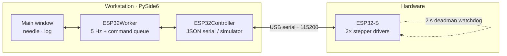

<div align="center">

```
╔══════════════════════════════════════════════════════════════════════════╗
║                                                                          ║
║    N E E D L E   M O T I O N   C O N T R O L                             ║
║    teleoperation workstation  ·  ESP32 2-DOF end-effector  ·  vision     ║
║                                                                          ║
╚══════════════════════════════════════════════════════════════════════════╝
```

**Insert, retract, rotate — from the keyboard, with live position and a full audit trail.**

> Axis 1 (insertion) is reported in **millimetres**, axis 2 (rotation) in **degrees**.

[](https://www.python.org/)
[](https://doc.qt.io/qtforpython/)
[](#-tests)
[](#-safety)

</div>

> **Scope note** — this workstation drives the **needle end-effector only**.
> The UR7e arm is commanded from its own interface (no joint/Cartesian jog panel here),
> and the ultrasound image is shown by **Echo Wave 2** in a separate application placed
> side by side with this window — this app captures and displays no camera frames.
> The `controllers/ur_controller.py` module stays in the repo as a standalone library
> (and is covered by tests), but it is not part of this window.

---

## What you get

| | |
|---|---|
| **Two-axis needle control** | `W`/`S` insertion and retraction, `A`/`D` clockwise / counter-clockwise rotation, arrow keys as aliases |
| **Live position readout** | Large per-axis values driven by the device's own step counter — no gyro or encoder required |
| **Repeatable jogs** | Each press is a relative `MOVE_REL`, so ten presses are ten steps instead of one step repeated |
| **Speed control** | Per-axis 1–90 °/s slider, presets `1`–`4` (2 / 10 / 25 / 60 °/s), fine tuning with `+` / `−` |
| **Motor + homing** | `M` toggles the stepper drivers, `H` zeroes both axes |
| **Audit log** | Every command, acknowledgement, rejection and safety event with millisecond timestamps |
| **Open-loop by design** | The firmware counts commanded steps; the PC mirrors that estimate, so no feedback sensor is needed |

---

## Architecture



```
proj-DP/
├── main.py                        entry point · logging · wiring
├── config.py / config.json        settings + validation
├── requirements.txt
│
├── controllers/
│   ├── esp32_controller.py        JSON protocol, open-loop position estimate
│   └── ur_controller.py           standalone arm library (not used by this UI)
│
├── vision/                        retained as a standalone module (not used by this UI)
│   ├── camera.py                  thread-safe OpenCV capture
│   └── needle_detector.py         YOLO / ONNX / Mock + annotation
│
├── workers/
│   ├── esp32_worker.py            5 Hz telemetry, serialised command queue
│   └── vision_worker.py           30 FPS capture → infer → annotate
│
├── interface/
│   ├── main_window.py             header, layout, hotkeys, log, master stop
│   ├── end_effector_panel.py      axis readouts, step/speed, connect, motors
│   ├── vision_panel.py            feed, camera controls, detection metrics
│   └── styles.py                  flat dark theme + status dots
│
├── firmware/esp32_controller/     stepper firmware + wiring guide
├── models/                        model drop-in guide
├── tests/                         21 automated tests
└── logs/teleop.log                rotating audit trail
```

### Window layout

```
┌───────────────────────────────────────────────────────────────────────────┐
│ NEEDLE MOTION CONTROL  [SIM]   ● End-effector online   ● Motors on  [STOP] │
├───────────────────────────────────────────────────────────────────────────┤
│ END-EFFECTOR                                                              │
│  ● Online   [COM3 ▾] [Scan] [Connect]   ● Motors on   [Enable] [Home]     │
│                                                                               │
│ AXIS 1 · INSERTION                                                            │
│  +12.00 mm  ● Homed    −180 mm … +180 mm  Step 1.00 mm  Speed ▬▬●──  20 mm/s [−][+] │
│                                                                               │
│ AXIS 2 · ROTATION                                                             │
│  −90.00 °   ● Homed    −360° … +360°     Step 15.0 °   Speed ▬▬●──  25 °/s  [−][+] │
├───────────────────────────────────────────────────────────────────────────┤
│ SYSTEM LOG — EVENT & SAFETY AUDIT                                         │
│ [19:08:25.913] [ESP32  ] Move REL: axis 1 delta=+1.00 ° (speed=20.0 °/s)  │
│ [19:08:25.941] [ESP32  ] Command #12 rejected: Motors disabled  Press [M] │
└───────────────────────────────────────────────────────────────────────────┘
```

---

## Quickstart

```bash
pip install -r requirements.txt
python main.py
```

On launch the app runs in **simulation**, auto-connects the virtual end-effector and
enables its drivers. Press:

| Key | Action |
|:--|:--|
| `W` / `↑` | Insert (axis 1 +) |
| `S` / `↓` | Retract (axis 1 −) |
| `A` / `←` | Rotate CCW (axis 2 −) |
| `D` / `→` | Rotate CW (axis 2 +) |
| `1` `2` `3` `4` | Speed presets: 2 / 10 / 25 / 60 °/s |
| `+` / `−` | Speed ±5 °/s |
| `M` | Enable / disable drivers |
| `H` | Home both axes |
| `Space` | **ALL STOP** |

The readouts step immediately while connected; telemetry then confirms them. Keys are
ignored while you are typing in the log console.

---

## Configuration

`config.json` is validated and clamped on load. Safety values default to `null` on purpose.

```json
{
  "esp32":   { "serial_port": null, "baud_rate": 115200, "enabled": false },
  "camera":  { "index": 0, "width": 640, "height": 480, "fps": 30 },
  "vision":  { "model_path": null, "confidence_threshold": 0.5, "enabled": false },
  "application": { "simulation_mode": true, "log_level": "INFO" }
}
```

| Setting | Default | Effect |
|:--|:--|:--|
| `application.simulation_mode` | `true` | `false` talks to the real ESP32 |
| `esp32.serial_port` | `null` | e.g. `COM3` or `/dev/ttyUSB0` |
| `esp32.baud_rate` | `115200` | must match `Serial.begin()` in the firmware |
| `vision.model_path` | `null` | `.pt` or `.onnx`; `null` uses the mock detector |
| `camera.index` | `0` | OpenCV device index |
| `application.log_level` | `INFO` | `DEBUG` for protocol chatter |

---

## Serial protocol

Newline-delimited JSON, request/response matched by `id`, protocol `v: 1`.
Axis ids are **1-based**; `0` means "both" for `HOME` only.

```json
{"v":1,"id":7,"cmd":"MOVE_REL","axis":1,"delta_deg":1.0,"speed":20.0}
{"v":1,"id":7,"ok":true,"status":"accepted"}
{"v":1,"id":7,"ok":false,"status":"rejected","error":"Motors disabled"}
```

Telemetry (unsolicited, ~5 Hz):

```json
{"v":1,"type":"telemetry","connected":true,"enabled":true,
 "axes":[{"axis":1,"position_deg":12.0,"homed":true,"moving":false},
         {"axis":2,"position_deg":-90.0,"homed":true,"moving":false}]}
```

| `cmd` | Parameters | Purpose |
|:--|:--|:--|
| `CONNECT` / `DISCONNECT` | — | Session handshake |
| `ENABLE` / `DISABLE` | — | Driver enable line |
| `MOVE_ABS` | `axis`, `target_deg`, `speed` | Bounded absolute move |
| `MOVE_REL` | `axis`, `delta_deg`, `speed` | Relative jog (keyboard) |
| `HOME` | `axis` (`0` = both) | Zero the axis / axes |
| `STOP` | — | Immediate pulse halt |
| `GET_STATUS` | — | Axis + flag snapshot |
| `HEARTBEAT` | — | Feeds the 2 s watchdog |

Moves are rejected until motor parameters (steps/degree, travel limits) are calibrated and
the drivers are enabled. The firmware heartbeats every 0.5 s and stops pulsing after 2 s
of silence from the PC.

---

## Tests

```bash
QT_QPA_PLATFORM=offscreen python -m pytest -q
# .....................  →  21 passed
```

| Suite | Tests | Covers |
|:--|:--:|:--|
| `test_config.py` | 3 | Defaults, save/reload, validation clamping |
| `test_esp32_protocol.py` | 6 | Connect, baud, sequence ids, uncalibrated rejection, moves + limits, homing |
| `test_gui.py` | 2 | Window startup/shutdown with audit log, keyboard teleoperation |
| `test_ur_controller.py` | 5 | Standalone arm library: state, jogging, limits, stop, disconnect |
| `test_vision.py` | 5 | Detection dataclass, mock contract, factory, annotation, camera lifecycle |

---

## Troubleshooting

| Symptom | Cause | Fix |
|:--|:--|:--|
| Readout stays at `+0.00 °`, header says offline | End-effector not connected | Press **Connect**; check the COM port |
| Log: `rejected: Motors disabled` | Drivers off | Press `M` (or **Enable motors**) |
| `Cannot move Axis 1: end-effector is not connected` | Command sent while offline | Connect first — offline presses never fake motion |
| Needle responds on the wrong axis | Old build with double-normalised axis ids | Update; axis ids are `1`/`2` on the wire |
| Every press moves the same distance | Legacy absolute-jog path | Fixed: jogs use `MOVE_REL` and accumulate |
| ESP32 stops mid-move | Heartbeat starved | Check the USB cable/port; the watchdog is working |

Logs: `logs/teleop.log`, and the on-screen audit console.

---

## Safety

> [!CAUTION]
> **Research platform — not a medical device.**
>
> 1. Use only on inanimate fixtures and tissue phantoms, under direct operator control.
> 2. **ALL STOP** (button or `Space`) is software convenience only. It does not replace the
>    physical Emergency Stop on the robot's control box.
> 3. Autonomous needle insertion is prohibited.
> 4. Needle positions are **commanded estimates** from the step counter — not a measurement.
> 5. Verify axis direction and travel limits on your mechanism before the first real move.

---

<div align="center">

`UR7e arm · separate interface`  ·  `needle end-effector · this window`  ·  `research use only`

</div>
